# YZIOW P28c — Chantier D.2.4 (Volet 1)
# Étude de l'Infrastructure Existante et Architecture Retenue pour l'Autorité WebAuthn Indépendante

> **Statut :** Document de préparation technique D.2.4 — **Aucun déploiement exécuté**.
> **Verrouillage actif :** `independent_admin_auth_ready = false`, `independent_fedapay_proof_ready = false`, `private_worm_storage_ready = false`, `SECURITY_BLOCKER`, `SAFE_DISABLED`, `READY_FOR_PRODUCTION = NO`.

---

## 1. Analyse de l'infrastructure existante YZIOW (Étape A)

### 1.1 Configuration Vercel et exécution du backend principal
- **Routage Vercel (`vercel.json` et `api/index.js`) :**
  - Le dépôt principal YZIOW est déployé sur Vercel (`version: 2`).
  - Toutes les requêtes `/api/(.*)` sont redirigées vers la fonction Serverless `api/index.js`, qui exporte l'application Express `backend/server.js`.
  - Toutes les autres routes servent le bundle SPA Vite (`index.html`).
- **Démarrage du backend principal (`backend/server.js`) :**
  - Au chargement, `backend/server.js` exige la présence de cinq variables d'environnement applicatives (`SUPABASE_URL`, `SUPABASE_SERVICE_ROLE_KEY`, `JWT_SECRET`, `AI_QUOTA_HASH_SECRET`, `PASSWORD_RESET_OTP_SECRET`).
  - Le backend principal n'utilise **pas** `DATABASE_URL` pour ses opérations courantes : il communique avec Supabase via `@supabase/supabase-js` (`SUPABASE_SERVICE_ROLE_KEY`, mappé au rôle PostgreSQL `service_role`) et, uniquement pour les RPC de rapprochement de remboursement Parent Pack (P28c), via un client `pg` utilisant `YZIOW_REFUND_DATABASE_URL` (rôle PostgreSQL dédié `yziow_refund_executor`).

### 1.2 Serveur d'autorité WebAuthn autonome (`backend/authority/webauthnAuthorityServer.js`)
- **Point d'entrée indépendant :**
  - Le fichier `backend/authority/webauthnAuthorityServer.js` (introduit en D.2.3) est un serveur HTTP Node.js autonome (`http.createServer`), totalement indépendant d'Express et de `backend/server.js`.
  - Il n'importe ni `backend/utils/supabase.js` ni `backend/server.js` et n'exige aucune des variables du backend applicatif (`SUPABASE_SERVICE_ROLE_KEY`, `JWT_SECRET`, `YZIOW_REFUND_DATABASE_URL`).
- **Dépendances logicielles strictes du serveur d'autorité :**
  - Modules natifs Node.js (`http`, `crypto`, `url`).
  - `@simplewebauthn/server` (`^14.1.0`) pour la vérification cryptographique FIDO2/WebAuthn CBOR/COSE/ECDSA P-256 et RSA.
  - `pg` (`^8.23.0`) pour la connexion PostgreSQL dédiée sous le rôle `yziow_webauthn_authority`.
  - **Correction préalable D.2.4 appliquée :** `pg` et `@simplewebauthn/server` sont désormais tous deux déclarés dans `dependencies` (dépendances de production) de `package.json`, `backend/package.json` et `package-lock.json` afin d'être installés lors d'un `npm ci --omit=dev`.
  - **Adaptation Cloud Run / conteneur D.2.4 appliquée :** `webauthnAuthorityServer.js` résout désormais le port via `YZIOW_WEBAUTHN_AUTHORITY_PORT` ou `process.env.PORT` et écoute sur `0.0.0.0` en environnement conteneurisé/Cloud Run, tout en conservant `127.0.0.1` par défaut pour les tests locaux.

### 1.3 Flux et routes HTTP WebAuthn entre le navigateur, le backend YZIOW et l'autorité
Le navigateur des SuperAdmins ne contacte pas directement l'autorité interne ; il interagit avec l'origine HTTPS YZIOW (`https://yziow.com`), et le backend YZIOW relaie les appels via `backend/services/webauthnAuthorityClient.js` :

| Action métier | Route publique Backend YZIOW (`superAdmin.js`) | Endpoint privé Autorité (`webauthnAuthorityServer.js`) | Rôle de l'Autorité |
|---|---|---|---|
|Santé du service | *(Usage interne / sonde)* | `GET /v1/health` | Vérification de disponibilité (`200 OK`) sans exposer de secret. |
| Challenge d'enrôlement | `POST /api/superadmin/webauthn/register/challenge` | `POST /v1/credentials/register/challenge` | Vérifie que le SuperAdmin est actif (`check_superadmin_active`) et persiste un challenge `register` dans `yziow_refund_auth.webauthn_challenges`. |
| Challenge de co-autorisation d'enrôlement | *(Appel inter-service / cérémonie)* | `POST /v1/credentials/enroll-approval/challenge` | Crée un challenge `enroll_approve` pour le second SuperAdmin distinct. |
| Confirmation matérielle de co-autorisation | *(Appel inter-service / cérémonie)* | `POST /v1/credentials/enroll-approval/confirm` | Vérifie l'assertion matérielle (`UP=1, UV=1`) du second SuperAdmin et émet un `enrollmentApprovalToken` adossé au challenge consommé. |
| Vérification et enregistrement de clé | `POST /api/superadmin/webauthn/register/verify` | `POST /v1/credentials/register/verify` | Exige inconditionnellement `requireEnrollmentApproval: true` et `requireBootstrapOrHardwareCoAuth: true` (`oob_bootstrap` si 0 clé active, ou co-autorisation matérielle sinon), consomme atomiquement le nonce du jeton dans `yziow_refund_auth.consumed_enrollment_tokens`, vérifie l'attestation CBOR/COSE et enregistre la clé publique dans `public.superadmin_webauthn_credentials`. |
| Révocation de clé | *(Administration d'autorité)* | `POST /v1/credentials/revoke` | Révoque immédiatement un `credential_id` (`is_active = false, revoked_at = clock_timestamp()`). |
| Challenge d'action financière (`initiate` / `approve`) | `POST /api/superadmin/webauthn/refund/challenge` | `POST /v1/actions/challenge` | Impose `enforceAuthoritativeDossierCheck: true` côté autorité (ignorant tout paramètre du backend), contre-vérifie directement le dossier de référence dans PostgreSQL (`inspect_authoritative_refund_dossier`) et crée un challenge lié au hash canonique du dossier. |
| Confirmation d'action et émission de preuve | `POST /api/superadmin/webauthn/refund/confirm` | `POST /v1/actions/confirm` | Impose `enforceAuthoritativeDossierCheck: true` côté autorité, contre-vérifie le dossier dans PostgreSQL, vérifie l'assertion matérielle (`UP=1, UV=1`, compteur monotone), consomme atomiquement le challenge et signe la preuve `v1-superadmin-refund-action-proof` avec `YZIOW_WEBAUTHN_AUTHORITY_SECRET`. |

---

## 2. Architecture Retenue (Recommandation Principale D.2.4)

### 2.1 Architecture recommandée : Option B (Service Node.js conteneurisé isolé dans un compte/projet cloud dédié) avec préparation à l'Option C (KMS)
L'architecture recommandée consiste à héberger `backend/authority/webauthnAuthorityServer.js` sur un **service conteneurisé Node.js dédié et isolé** (spécifiquement **Google Cloud Run** dans un projet GCP dédié à la sécurité, ou **Fly.io** dans une organisation dédiée), administrativement séparé de l'équipe/projet Vercel qui héberge le backend applicatif YZIOW.

```mermaid
flowchart LR
    subgraph Browser["Navigateur des 2 SuperAdmins"]
        SA1["SuperAdmin #1\nClé FIDO2 / Passkey"]
        SA2["SuperAdmin #2\nClé FIDO2 / Passkey"]
    end

    subgraph Vercel["Plateforme Principale YZIOW (Vercel)"]
        Backend["Backend Applicatif YZIOW\n(api/index.js -> backend/server.js)\nSANS clé de signature d'autorité\nSANS accès à yziow_refund_auth"]
    end

    subgraph IsolatedCloud["Unité d'Exécution Isolée (Cloud Run / Fly.io)"]
        Authority["Autorité WebAuthn Indépendante\n(webauthnAuthorityServer.js)\nDétient YZIOW_WEBAUTHN_AUTHORITY_SECRET\nDétient YZIOW_WEBAUTHN_BOOTSTRAP_SECRET"]
    end

    subgraph SupabasePG["Supabase PostgreSQL"]
        PublicSchema["Schéma public\n- payment_intents\n- parent_pack_refund_reconciliations\n- superadmin_webauthn_credentials\n(Rôle backend : yziow_refund_executor)"]
        AuthSchema["Schéma verrouillé yziow_refund_auth\n- authority_config\n- webauthn_challenges\n- consumed_action_proofs\n(Rôle autorité : yziow_webauthn_authority)"]
    end

    SA1 & SA2 -->|"WebAuthn (RP ID: yziow.com)\nOrigin: https://yziow.com"| Backend
    Backend -->|"HTTPS + Bearer YZIOW_BACKEND_TO_AUTHORITY_TOKEN\n(webauthnAuthorityClient.js)"| Authority
    Backend -->|"YZIOW_REFUND_DATABASE_URL\n(Rôle: yziow_refund_executor)"| PublicSchema
    Authority -->|"YZIOW_AUTH_AUTHORITY_DATABASE_URL\n(Rôle: yziow_webauthn_authority)"| AuthSchema
    Authority -.->|"Contre-vérification lecture seule\ninspect_authoritative_refund_dossier"| PublicSchema
    PublicSchema -.->|"Vérification atomique SECURITY DEFINER\nverify_and_consume_refund_action_proof"| AuthSchema
```

### 2.2 Justification technique du choix
1. **Séparation de la frontière d'administration (conditionnelle à une gouvernance IAM stricte) :**
   - Sur Vercel (plans Hobby et Pro), tous les membres disposant du rôle *Owner* ou *Member* au niveau de l'équipe ont accès aux variables d'environnement de l'ensemble des projets de l'équipe, sauf souscription à Vercel Enterprise avec RBAC par projet.
   - Héberger l'autorité sur un service conteneurisé dans un **compte/projet cloud séparé** (ex. projet GCP Cloud Run dédié ou organisation Fly.io dédiée, contrôlé uniquement par le propriétaire de YZIOW sans partage de comptes avec l'équipe Vercel) fournit une séparation effective : une compromission du runtime Serverless YZIOW ou d'un token de déploiement Vercel ne donne alors aucun accès à `YZIOW_WEBAUTHN_AUTHORITY_SECRET`, `YZIOW_WEBAUTHN_BOOTSTRAP_SECRET` ni `YZIOW_AUTH_AUTHORITY_DATABASE_URL`.
2. **Compatibilité avec Cloud Run / conteneur après les correctifs préalables D.2.4 :**
   - Suite aux adaptations D.2.4, `webauthnAuthorityServer.js` écoute sur `0.0.0.0` et utilise `process.env.PORT` (ou `YZIOW_WEBAUTHN_AUTHORITY_PORT`), `pg` et `@simplewebauthn/server` figurent dans les dépendances de production (`dependencies`), et l'anti-rejeu des jetons d'amorçage/co-autorisation est désormais persisté atomiquement dans PostgreSQL (`yziow_refund_auth.consumed_enrollment_tokens`) sans dépendre de la mémoire RAM ni d'un paramètre `max-instances = 1`.
3. **Support réseau IPv4 / IPv6 vers Supabase PostgreSQL :**
   - Contrairement aux fonctions Serverless Vercel qui sont strictement IPv4 en sortie, un conteneur isolé peut se connecter soit via le pooler Supavisor IPv4 (`aws-0-<region>.pooler.supabase.com`), soit en connexion directe IPv6 (`db.<project_ref>.supabase.co:5432`) si le réseau du conteneur active l'IPv6.
4. **Évolutivité transparente vers KMS (Option C) :**
   - Sur Google Cloud Run, l'autorité peut ultérieurement déléguer la clé `YZIOW_WEBAUTHN_AUTHORITY_SECRET` ou `YZIOW_WEBAUTHN_BOOTSTRAP_SECRET` à Google Cloud KMS (`GenerateMac` / `VerifyMac` HMAC-SHA256) sans changer l'architecture réseau entre Vercel et l'autorité.
