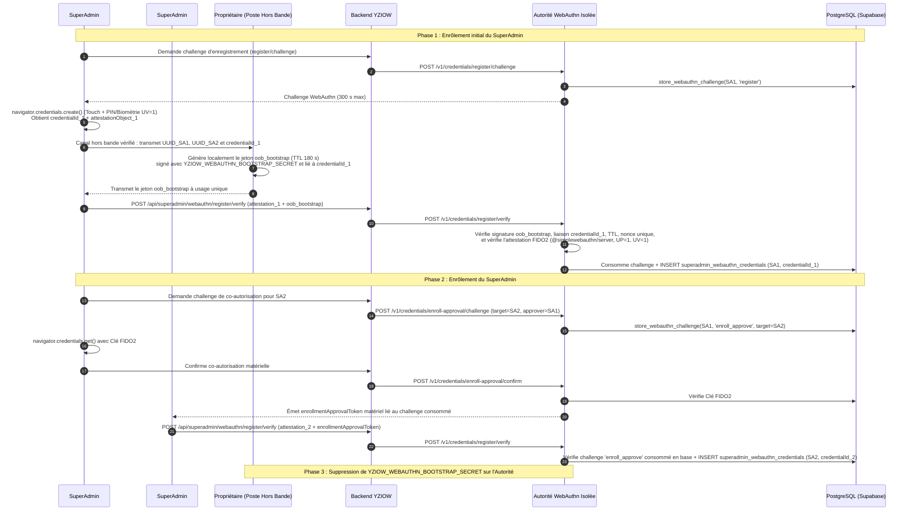

# YZIOW P28c — Chantier D.2.4 (Volet 4)
# Procédure Opérationnelle d'Enrôlement Initial, de Co-Autorisation Matérielle, de Remplacement et de Révocation des Deux SuperAdmins (Étape E)

> **Statut :** Document de préparation technique D.2.4 — **Aucun enrôlement réel exécuté, aucun jeton `oob_bootstrap` de production émis**.

---

## 1. Principes de sécurité de la cérémonie d'enrôlement (Trust-On-First-Use contrôlé)

Lorsque la table `public.superadmin_webauthn_credentials` contient **zéro (`0`) authentificateur actif**, un backend applicatif totalement compromis ne doit **jamais** pouvoir enregistrer lui-même deux clés WebAuthn contrôlées par l'attaquant.

Le code D.2.3 (`webauthnAuthorityServer.js` + `superAdminWebAuthnAuthority.js`) applique à cet effet trois verrous cumulatifs sur `POST /v1/credentials/register/verify` :
1. **Imposition inconditionnelle côté autorité :** le serveur d'autorité force `requireEnrollmentApproval: true` et `requireBootstrapOrHardwareCoAuth: true`, ignorant toute valeur envoyée par le backend.
2. **Interdiction des jetons logiciels à l'état `0` clé :** tant qu'aucun SuperAdmin approbateur ne possède d'authentificateur matériel actif (`!approverHasActiveWebAuthn`), tout jeton logiciel est rejeté avec `BOOTSTRAP_OUT_OF_BAND_AUTHORIZATION_REQUIRED`.
3. **Liaison cryptographique stricte au `credentialId` :** le jeton hors bande `oob_bootstrap` est signé avec `YZIOW_WEBAUTHN_BOOTSTRAP_SECRET` (secret absent du backend) et inclut dans son payload canonique `v1-webauthn-oob-bootstrap|target_admin_id|approver_admin_id|credential_id|purpose|issued_at|expires_at|nonce` l'identifiant exact `credentialId` généré par l'authentificateur physique du SuperAdmin.

---

## 2. Rôles et responsabilités lors de la cérémonie initiale

| Acteur | Identité / Fonction | Responsabilité pendant la cérémonie |
|---|---|---|
| **Autorité d'Amorçage (Propriétaire YZIOW)** | Propriétaire du projet YZIOW (accès exclusif hors bande au secret `YZIOW_WEBAUTHN_BOOTSTRAP_SECRET` sur son poste d'administration sécurisé) | Vérifie en personne ou par visioconférence synchrone l'identité physique des deux SuperAdmins et génère en local le jeton unique `oob_bootstrap` pour le SuperAdmin #1. |
| **SuperAdmin #1 (`Admin A`)** | Premier administrateur habilité aux opérations de remboursement Parent Pack (`is_active = true` dans `public.superadmins`) | Génère la première paire de clés sur son authentificateur physique FIDO2/WebAuthn (YubiKey / Passkey avec PIN/biométrie `UV=1`), communique hors bande son `credentialId` au Propriétaire, puis co-autorise matériellement l'enrôlement du SuperAdmin #2. |
| **SuperAdmin #2 (`Admin B`)** | Second administrateur habilité distinct (`Admin B != Admin A`, `is_active = true` dans `public.superadmins`) | Génère sa paire de clés sur son propre authentificateur physique FIDO2/WebAuthn et finalise son enregistrement grâce au jeton de co-autorisation matériel signé par l'authentificateur physique du SuperAdmin #1. |

---

## 3. Procédure étape par étape du premier enrôlement (`0` authentificateur actif)

### Détail des contrôles sur le jeton `oob_bootstrap`
1. **Vérification d'identité hors bande :** Le Propriétaire vérifie de visu (ou par appel vidéo synchrone authentifié) l'identité de `Admin A` et `Admin B`, ainsi que leurs UUID exacts dans `public.superadmins`.
2. **Génération locale hors bande :** Sur son poste local (sans jamais exposer `YZIOW_WEBAUTHN_BOOTSTRAP_SECRET` au backend), le Propriétaire appelle `issueOutOfBandBootstrapToken` avec :
   - `targetAdminId` = UUID de `Admin A`
   - `approverAdminId` = UUID de `Admin B` (doit être actif et distinct de `Admin A`)
   - `credentialId` = identifiant exact `rawId` (base64url) produit par la clé matérielle de `Admin A`
   - `validitySeconds` = `180` (3 minutes)
3. **Usage unique persistant PostgreSQL et anti-détournement :**
   - Si un backend compromis intercepte le jeton `oob_bootstrap` en transit et tente de l'utiliser pour enregistrer une clé d'attaquant (`credentialId_attaquant != credentialId_1`), l'autorité rejette immédiatement l'appel avec `INVALID_ENROLLMENT_APPROVAL_TOKEN` (*« Le jeton d'amorçage hors bande est lié à un autre credentialId »*).
   - Dès que `credentialId_1` est enregistré, le `nonce` du jeton est consommé de façon atomique et persistante dans la table PostgreSQL `yziow_refund_auth.consumed_enrollment_tokens` via la fonction `SECURITY DEFINER` `yziow_refund_auth.consume_enrollment_approval_token` (`INSERT ... ON CONFLICT (token_nonce) DO NOTHING`). Tout rejeu (concurrent ou après redémarrage du processus d'autorité) renvoie `INVALID_ENROLLMENT_APPROVAL_TOKEN`.
4. **Neutralisation post-cérémonie :** Une fois `Admin A` et `Admin B` tous deux enrôlés, le Propriétaire retire `YZIOW_WEBAUTHN_BOOTSTRAP_SECRET` de la configuration de l'autorité WebAuthn et redémarre le conteneur d'autorité.

---

## 4. Procédure de remplacement d'une clé perdue ou compromise

### Cas A — Un seul SuperAdmin a perdu sa clé (l'autre SuperAdmin possède toujours sa clé matérielle active)
1. Aucun secret d'amorçage `oob_bootstrap` n'est nécessaire.
2. Le SuperAdmin disposant toujours de sa clé matérielle active demande un challenge `enroll_approve` (`purpose = 'credential_replacement'`) ciblant l'UUID du SuperAdmin dont la clé doit être remplacée, et signe ce challenge avec son authentificateur physique (`UP=1, UV=1`).
3. L'autorité vérifie cette signature matérielle, marque le challenge `enroll_approve` comme consommé dans `yziow_refund_auth.webauthn_challenges` et délivre un `enrollmentApprovalToken`.
4. Le SuperAdmin cible enregistre sa nouvelle clé matérielle : dans une **transaction PostgreSQL unique**, l'autorité révoque automatiquement toutes ses clés précédentes (`UPDATE public.superadmin_webauthn_credentials SET is_active = false, revoked_at = clock_timestamp() WHERE admin_id = $1 AND is_active = true`) et insère la nouvelle clé avec `sign_count = 0`.

### Cas B — Perte simultanée des clés des deux SuperAdmins (scénario de reprise après sinistre)
1. Le Propriétaire révoque en base toutes les clés actives des deux SuperAdmins (`UPDATE public.superadmin_webauthn_credentials SET is_active = false, revoked_at = clock_timestamp()`).
2. Le Propriétaire injecte temporairement un nouveau `YZIOW_WEBAUTHN_BOOTSTRAP_SECRET` sur l'autorité isolée, exécute la procédure complète de la Section 3 (Phases 1 et 2), puis supprime à nouveau `YZIOW_WEBAUTHN_BOOTSTRAP_SECRET`.

---

## 5. Procédure de révocation immédiate d'un authentificateur ou d'un SuperAdmin

1. **Révocation immédiate via l'API d'autorité :**
   - Appel à `POST /v1/credentials/revoke` (`{ credentialId, adminId }`) qui exécute :
     `UPDATE public.superadmin_webauthn_credentials SET is_active = false, revoked_at = clock_timestamp() WHERE credential_id = $1 AND admin_id = $2 AND is_active = true`.
2. **Révocation d'urgence directe dans PostgreSQL (par le Propriétaire) :**
   - Pour révoquer la clé :
     `UPDATE public.superadmin_webauthn_credentials SET is_active = false, revoked_at = clock_timestamp() WHERE credential_id = '<CREDENTIAL_ID>';`
   - Pour suspendre immédiatement le compte SuperAdmin :
     `UPDATE public.superadmins SET is_active = false WHERE id = '<ADMIN_UUID>';`
3. **Effet immédiat sur les preuves déjà émises mais non encore consommées :**
   - Même si une preuve `actionProof` avait été émise quelques secondes avant la révocation, la fonction SQL `yziow_refund_auth.verify_and_consume_refund_action_proof` revérifie au moment de l'exécution du RPC que `superadmins.is_active = true` **et** que `superadmin_webauthn_credentials.is_active = true AND revoked_at IS NULL`. Toute preuve issue d'une clé révoquée est donc immédiatement bloquée par PostgreSQL (`WEBAUTHN_CREDENTIAL_INACTIVE_OR_REVOKED`).
