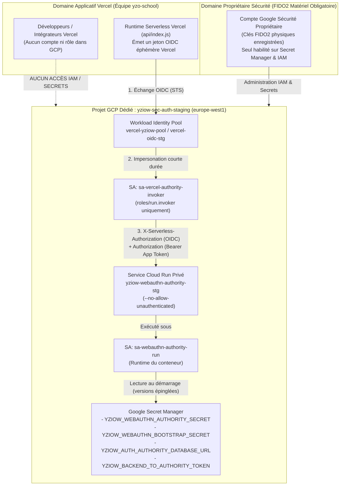

# YZIOW P28c — Chantier D.2.5 (Volet 1)
# Architecture Cible Google Cloud Run, Gouvernance du Projet GCP et Frontière de Confiance

> **Statut :** Dossier de planification stricte D.2.5 — **Aucune ressource cloud créée, aucun compte ouvert, aucune facturation activée**.
> **Verrouillage actif :** `independent_admin_auth_ready = false`, `independent_fedapay_proof_ready = false`, `private_worm_storage_ready = false`, `SECURITY_BLOCKER`, `SAFE_DISABLED`, `READY_FOR_PRODUCTION = NO`.
> **Références internes :** [p28c-d24-01-architecture-retenue.md](file:///C:/Users/acer/Downloads/D-ambassador-fix/worktrees/p28c-clean/docs/p28c-d24-01-architecture-retenue.md), [webauthnAuthorityServer.js](file:///C:/Users/acer/Downloads/D-ambassador-fix/worktrees/p28c-clean/backend/authority/webauthnAuthorityServer.js).

---

## 1. Synthèse des 10 Réponses Structurantes pour l'Autorisation Propriétaire

| # | Question du propriétaire | Réponse technique de référence |
|---|---|---|
| **1** | **Quelles ressources Google Cloud devront être créées ?** | Un projet GCP dédié (`yziow-sec-auth-staging`), 1 dépôt Artifact Registry régional (`yziow-authority-repo`), 1 service Cloud Run privé (`yziow-webauthn-authority-stg`), 4 secrets Secret Manager, 1 Workload Identity Pool + Provider OIDC Vercel, et 3 Service Accounts à privilèges minimaux. |
| **2** | **Quels comptes ou rôles administreront ces ressources ?** | Uniquement le compte Google d'administration sécurité du propriétaire (protégé par clés FIDO2 matérielles / Google Advanced Protection). Aucun compte développeur Vercel n'a de rôle sur ce projet GCP. Aucun rôle large `roles/owner` ou `roles/editor` n'est attribué aux comptes techniques. |
| **3** | **Comment l'autorité sera-t-elle indépendante du backend Vercel ?** | Hébergée dans un projet Google Cloud distinct, sous une identité IAM propre (`sa-webauthn-authority-run`), détenant seule `YZIOW_WEBAUTHN_AUTHORITY_SECRET`, `YZIOW_WEBAUTHN_BOOTSTRAP_SECRET` et `YZIOW_AUTH_AUTHORITY_DATABASE_URL`. Une compromission totale de Vercel (code, runtime et variables d'environnement) ne permet ni de lire ces secrets ni d'accéder au schéma PostgreSQL `yziow_refund_auth`. |
| **4** | **Comment Vercel pourra-t-il appeler un service Cloud Run privé ?** | Via une double authentification implémentée dans [webauthnAuthorityClient.js](file:///C:/Users/acer/Downloads/D-ambassador-fix/worktrees/p28c-clean/backend/services/webauthnAuthorityClient.js) (D.2.5b DEP-1) : (a) **couche infrastructure IAM** (`X-Serverless-Authorization: Bearer <GOOGLE_OIDC_ID_TOKEN>`) obtenue par fédération OIDC sans clé statique (Workload Identity Federation STS entre Vercel OIDC et le compte `sa-vercel-authority-invoker` doté uniquement de `roles/run.invoker`), et (b) **couche applicative** (`Authorization: Bearer <YZIOW_BACKEND_TO_AUTHORITY_TOKEN>`). |
| **5** | **Comment l'autorité accédera-t-elle à Supabase Staging ?** | En IPv4 chiffré TLS (`sslmode=verify-full`) vers le pooler **Supavisor Session Mode sur le port `5432`** (`aws-0-<region>.pooler.supabase.com:5432`) sous l'identifiant qualifié `yziow_webauthn_authority.<STAGING_PROJECT_REF>`. |
| **6** | **Comment protéger les secrets WebAuthn et les droits PostgreSQL ?** | Secrets injectés dans Cloud Run depuis Google Cloud Secret Manager par version épinglée (accès `roles/secretmanager.secretAccessor` limité secret par secret au seul `sa-webauthn-authority-run`). Toute identité pouvant déployer une révision Cloud Run (`sa-authority-deployer`) est traitée comme une **identité critique de niveau Tier-0** (pouvant accéder indirectement aux secrets via une révision modifiée) et soumise à 0 privilège permanent. Côté PostgreSQL, `REVOKE ALL` sur `yziow_refund_auth` et `public.superadmin_webauthn_credentials` pour `yziow_refund_executor`, `service_role`, `authenticated`, `anon` et `PUBLIC`. |
| **7** | **Comment construire et tester l'image Node.js ?** | Image multi-étapes basée sur `node:22.14.0-bookworm-slim` (épinglée par digest SHA-256), `ENV PUPPETEER_SKIP_DOWNLOAD=true`, `npm ci --omit=dev --ignore-scripts`, conservant `/app/backend/package.json` (`"type": "commonjs"`), exécutée sous l'utilisateur non privilégié `node` (UID `1000`), avec arrêt propre `SIGTERM` drainant les requêtes et fermant le pool PostgreSQL (D.2.5b DEP-3). |
| **8** | **Comment garantir que les remboursements restent bloqués ?** | Les 3 drapeaux de `public.parent_pack_refund_security_gate` restent à `false` dans la migration et en base, maintenant `SECURITY_BLOCKER` en SQL et `SAFE_DISABLED` dans [parentPackService.js](file:///C:/Users/acer/Downloads/D-ambassador-fix/worktrees/p28c-clean/backend/services/parentPackService.js). Le rôle `yziow_webauthn_authority` n'a aucun droit d'écriture sur les tables financières ni sur la security gate. |
| **9** | **Quels coûts pourraient être engagés ?** | En préproduction maîtrisée (`min-instances = 0`, `max-instances = 2`, 4 versions de secrets, image < 200 Mo), la consommation entre dans les quotas gratuits mensuels GCP (coût estimé `0,00 $` à `< 1,00 $ / mois`), sous réserve de la politique du projet Supabase Staging (`Free` à `0 $` ou instance dédiée `~10–25 $ / mois`). |
| **10** | **Quelles actions nécessiteront une nouvelle autorisation explicite ?** | Les dépendances techniques D.2.5b (DEP-1, DEP-2, DEP-3) étant désormais résolues dans le code, les prochaines actions soumises à autorisation explicite sont : (1) commit/push de D.2.5/D.2.5b, (2) création du projet GCP et activation de la facturation avec budget d'alerte, (3) création du projet Supabase Staging et exécution des migrations, (4) build/push de l'image et déploiement Cloud Run Staging, (5) exécution de la recette préproduction. |

---

## 2. Conception du Projet Google Cloud Dédié (Étape A)

### 2.1 Convention de nommage normative

Afin de séparer strictement la préproduction (Staging) et une éventuelle production future, les identifiants suivants sont proposés :

| Élément | Nom proposé (Préproduction / Staging) | Nom réservé (Production future — hors périmètre D.2.5) |
|---|---|---|
| **Project ID GCP** | `yziow-sec-auth-staging` | `yziow-sec-auth-prod` |
| **Nom d'affichage du projet** | `YZIOW Security WebAuthn Authority (Staging)` | `YZIOW Security WebAuthn Authority (Prod)` |
| **Région Cloud Run & Artifact Registry** | `europe-west1` (Belgique) | `europe-west1` (Belgique) |
| **Dépôt Artifact Registry** | `yziow-authority-repo` | `yziow-authority-repo` |
| **Service Cloud Run** | `yziow-webauthn-authority-stg` | `yziow-webauthn-authority-prd` |
| **Service Account d'exécution Cloud Run** | `sa-webauthn-authority-run@yziow-sec-auth-staging.iam.gserviceaccount.com` | `sa-webauthn-authority-run@yziow-sec-auth-prod.iam.gserviceaccount.com` |
| **Service Account d'invocation Vercel** | `sa-vercel-authority-invoker@yziow-sec-auth-staging.iam.gserviceaccount.com` | `sa-vercel-authority-invoker@yziow-sec-auth-prod.iam.gserviceaccount.com` |
| **Service Account de déploiement CI/Image** | `sa-authority-deployer@yziow-sec-auth-staging.iam.gserviceaccount.com` | `sa-authority-deployer@yziow-sec-auth-prod.iam.gserviceaccount.com` |
| **Workload Identity Pool / Provider** | Pool : `vercel-yziow-pool` / Provider : `vercel-oidc-stg` | Pool : `vercel-yziow-pool` / Provider : `vercel-oidc-prd` |

### 2.2 Choix et justification de la région Cloud Run : `europe-west1` (Belgique)

| Critère | `europe-west1` (Belgique — **Recommandée**) | `europe-west9` (Paris — Alternative) |
|---|---|---|
| **Tarification Google Cloud Run** | **Tier 1** (tarif vCPU/GiB le plus bas en Europe) | **Tier 2** (+~20 % sur le tarif vCPU/GiB au-delà du Free Tier) |
| **Latence réseau vers Vercel (`cdg1` Paris / `fra1` Francfort)** | **~6 à 12 ms RTT** | ~2 à 8 ms RTT |
| **Latence vers Supabase Europe (`eu-west-1` Irlande / `eu-central-1` Francfort / `eu-west-3` Paris)** | **~7 à 14 ms RTT** | ~3 à 15 ms RTT |
| **Disponibilité et redondance** | Multi-zone complète (3 zones : `b`, `c`, `d`), SLA 99,95 % | Multi-zone (3 zones : `a`, `b`, `c`), SLA 99,95 % |
| **Disponibilité des services (Cloud Run, Secret Manager, Artifact Registry)** | Complète | Complète |

**Justification :** `europe-west1` (Saint-Ghislain, Belgique) combine une latence inférieure à 15 ms avec les régions européennes de Vercel et de Supabase tout en bénéficiant de la grille tarifaire **Tier 1** de Google Cloud.

---

## 3. Organisation Administrative et Séparation des Comptes

### 3.1 Frontière administrative stricte entre Vercel et Google Cloud

### 3.2 Règles impératives d'hygiène administrative

1. **Séparation des identités humaines :**
   - Le projet `yziow-sec-auth-staging` est administré exclusivement par l'identité Google de sécurité du propriétaire de YZIOW.
   - Aucun compte collaborateur ayant accès à l'équipe Vercel ou au dépôt GitHub général ne reçoit de rôle dans `yziow-sec-auth-staging`.
2. **MFA matériel FIDO2 obligatoire :**
   - Le compte Google administrateur du propriétaire doit avoir la validation en deux étapes activée avec **au moins deux clés de sécurité matérielles FIDO2/WebAuthn** (une principale, une de secours hors site) et, idéalement, le programme *Google Advanced Protection*.
3. **Neutralisation du compte de service Compute Engine par défaut :**
   - Dès la création future du projet GCP, le compte par défaut `<PROJECT_NUMBER>-compute@developer.gserviceaccount.com` (qui reçoit autrement le rôle excessif `roles/editor`) doit être **désactivé** ou privé de tout rôle IAM (`organization/iam.automaticIamGrantsForDefaultServiceAccounts` désactivé).
4. **Interdiction des rôles primitifs (`Owner` / `Editor`) sur les comptes techniques :**
   - Aucun Service Account (`sa-webauthn-authority-run`, `sa-vercel-authority-invoker`, `sa-authority-deployer`) ne reçoit `roles/owner`, `roles/editor`, ni `roles/viewer` au niveau du projet.
5. **Cloisonnement de la lecture des secrets et classification critique (Tier-0) de l'identité de déploiement (Revue IAM D.2.5b — Étape 4) :**
   - Seul le compte d'exécution `sa-webauthn-authority-run` dispose de `roles/secretmanager.secretAccessor`, accordé individuellement sur chacun des 4 secrets requis (et non au niveau global du projet).
   - **Attention critique (escalade indirecte via déploiement) :** Bien que `sa-authority-deployer` ne possède pas directement `roles/secretmanager.secretAccessor`, le fait de détenir conjointement `roles/run.developer` sur le service Cloud Run et `roles/iam.serviceAccountUser` sur `sa-webauthn-authority-run` permettrait à un attaquant compromettant `sa-authority-deployer` de déployer une révision conteneur modifiée s'exécutant sous `sa-webauthn-authority-run` et d'accéder ainsi **indirectement** à tous les secrets montés dans l'autorité (`YZIOW_WEBAUTHN_AUTHORITY_SECRET`, `YZIOW_AUTH_AUTHORITY_DATABASE_URL`, `YZIOW_WEBAUTHN_BOOTSTRAP_SECRET`).
   - En conséquence, `sa-authority-deployer` est classé comme une **identité privilégiée de niveau critique (Tier-0, équivalente en sensibilité aux secrets de l'autorité)** et soumis aux quatre contrôles obligatoires suivants :
     1. **Pas d'utilisation permanente (Zero Standing Privilege) :** `sa-authority-deployer` est **désactivé par défaut** (`gcloud iam service-accounts disable`) et ne possède aucune clé statique ni liaison CI/CD permanente vers GitHub ou Vercel.
     2. **Autorisation explicite et temporaire :** Lors d'une mise à jour explicitement autorisée par le propriétaire, l'attribution de `roles/run.developer` et `roles/iam.serviceAccountUser` est bornée dans le temps par une **IAM Condition d'expiration** (`request.time < timestamp("...")`, fenêtre maximale de 30 minutes) ou via *Google Cloud Privileged Access Manager (PAM)* avec approbation manuelle FIDO2 du propriétaire, puis le compte est immédiatement re-désactivé après déploiement.
     3. **Contrôle strict des déploiements :** Déploiement exclusivement par digest immuable `@sha256:...` construit à partir d'un commit Git signé/vérifié, avec politique **Binary Authorization** sur le service Cloud Run n'autorisant que les images attestées par le propriétaire sécurité, et interdiction de modifier la liste des secrets ou le compte runtime sans revue propriétaire.
     4. **Journalisation et traçabilité intégrales :** Journalisation obligatoire dans Cloud Audit Logs (`Admin Activity` + `Data Access` sur Cloud Run, IAM et Secret Manager) et alerte temps réel sur toute activation de `sa-authority-deployer`, tout appel `iam.serviceAccounts.actAs` sur `sa-webauthn-authority-run` ou tout appel `run.services.update`.
6. **Prévention des accès non autorisés à la facturation :**
   - Le compte de facturation Google Cloud (*Cloud Billing Account*) est administré uniquement par le propriétaire (`roles/billing.admin`). Aucun Service Account ni rôle technique du projet n'a le droit de modifier le compte de facturation (`billing.resourceAssociations.create` / `billing.accounts.update`).

---

## 4. Matrice Normative IAM (Étape A & Revue IAM D.2.5b)

Format : `Identité → Ressource → Permission / Rôle → Justification → Risque en cas de compromission et mesure d'atténuation`

| Identité | Ressource cible | Permission / Rôle GCP minimal | Justification technique | Risque résiduel & Atténuation |
|---|---|---|---|---|
| **Propriétaire Sécurité YZIOW** *(Compte humain protégé par FIDO2)* | Projet `yziow-sec-auth-staging` & Compte de facturation | `roles/resourcemanager.projectIamAdmin`, `roles/secretmanager.admin`, `roles/run.admin`, `roles/billing.admin` | Gouvernance initiale, création des secrets hors bande, révocation d'urgence. | **Risque :** Compromission du compte propriétaire. **Atténuation :** Clés FIDO2 physiques obligatoires + alertes Cloud Audit Logs sur toute action IAM ou Secret Manager. |
| **`sa-webauthn-authority-run`** *(Identité d'exécution du conteneur Cloud Run)* | Secrets individuels Secret Manager : - `yziow-webauthn-authority-secret` - `yziow-webauthn-bootstrap-secret` - `yziow-auth-authority-db-url` - `yziow-backend-to-authority-token` | `roles/secretmanager.secretAccessor` *(accordé ressource par ressource, jamais au niveau projet)* | Permet à Cloud Run d'injecter ces 4 secrets dans le conteneur `webauthnAuthorityServer.js` au démarrage d'une révision. | **Risque :** Exfiltration si RCE dans le conteneur d'autorité. **Atténuation :** Conteneur minimal sans shell interactif exposé, `yziow_webauthn_authority` ne peut déclencher aucun remboursement en base (`REVOKE ALL` sur les tables financières et sur `parent_pack_refund_security_gate`). |
| **`sa-webauthn-authority-run`** | Cloud Logging du projet `yziow-sec-auth-staging` | `roles/logging.logWriter` | Écriture des journaux structurés d'exécution et d'audit du conteneur. | **Risque :** Saturation de logs. **Atténuation :** Quotas d'ingestion Cloud Logging + aucun secret journalisé. |
| **`sa-vercel-authority-invoker`** *(Identité fédérée appelée par Vercel)* | Service Cloud Run `yziow-webauthn-authority-stg` *(uniquement ce service)* | `roles/run.invoker` (`run.routes.invoke`) | Autorise le franchissement de la passerelle IAM Cloud Run via un jeton OIDC Google valide dans `X-Serverless-Authorization`. | **Risque :** Compromission du runtime Vercel. **Atténuation :** Ce compte n'a **aucun** accès à Secret Manager, Artifact Registry ou Logging, et l'autorité exige toujours une assertion matérielle WebAuthn (`UP=1, UV=1`) + la contre-vérification PostgreSQL `inspect_authoritative_refund_dossier`. |
| **Principal OIDC Vercel** (`principalSet://iam.googleapis.com/projects/<NUM>/locations/global/workloadIdentityPools/vercel-yziow-pool/...`) | Service Account `sa-vercel-authority-invoker` | `roles/iam.workloadIdentityUser` (`iam.serviceAccounts.getOpenIdToken`) | Permet au runtime Vercel (et uniquement au projet/environnement autorisé par condition d'attribut OIDC) d'obtenir un ID Token OIDC pour `sa-vercel-authority-invoker`. | **Risque :** Usurpation par un autre projet Vercel. **Atténuation :** Condition IAM stricte sur `assertion.sub` vérifiant le `project_id` et l'`environment` Vercel exacts. |
| **`sa-authority-deployer`** *(Identité privilégiée critique **Tier-0** de déploiement d'image — **Zéro privilège permanent**)* | Dépôt Artifact Registry `yziow-authority-repo` | `roles/artifactregistry.writer` *(uniquement sous fenêtre temporelle autorisée)* | Dépôt de l'image conteneur vérifiée par digest SHA-256. | **Risque critique :** Publication d'une image malveillante destinée à être exécutée par Cloud Run. **Atténuation Tier-0 :** (1) Compte **désactivé par défaut** hors fenêtre de déploiement ; (2) Élévation temporaire explicite (`request.time < timestamp(...)` max 30 min) approuvée par FIDO2 propriétaire ; (3) Attestation Binary Authorization sur le digest SHA-256. |
| **`sa-authority-deployer`** *(Identité privilégiée critique **Tier-0** — **Accès indirect aux secrets**)* | Service Cloud Run `yziow-webauthn-authority-stg` & `sa-webauthn-authority-run` | `roles/run.developer` + `roles/iam.serviceAccountUser` *(uniquement sur `sa-webauthn-authority-run` et sous condition IAM temporelle stricte)* | Déploiement d'une révision Cloud Run utilisant le compte d'exécution dédié. | **Risque critique (Escalade indirecte vers les secrets) :** Un attaquant compromettant ce compte pourrait déployer une révision modifiée sous `sa-webauthn-authority-run` et exfiltrer indirectement `YZIOW_WEBAUTHN_AUTHORITY_SECRET`, `YZIOW_WEBAUTHN_BOOTSTRAP_SECRET` et `YZIOW_AUTH_AUTHORITY_DATABASE_URL`. **Atténuation Tier-0 :** (1) **Pas d'utilisation permanente** (compte désactivé au repos, aucun token CI permanent) ; (2) **Autorisation explicite et temporaire** (IAM Condition horodatée / PAM) ; (3) **Contrôle des déploiements** (digest SHA-256 épinglé + Binary Authorization) ; (4) **Journalisation et traçabilité** (Cloud Audit Logs `Admin Activity` + alerte critique immédiate sur `UpdateService` et `actAs`). |

---

## 5. Journalisation, Supervision et Contrôle des Accès aux Déploiements

### 5.1 Activation des Cloud Audit Logs

Dans le projet `yziow-sec-auth-staging` :
- **Admin Activity Audit Logs** (activés par défaut et gratuits) : enregistrent toute modification IAM, création/suppression de version de secret, ou déploiement de révision Cloud Run.
- **Data Access Audit Logs pour Secret Manager (`secretmanager.googleapis.com`)** : activer explicitement `DATA_READ` et `DATA_WRITE` afin que toute lecture d'un secret (y compris le montage par Cloud Run ou un accès manuel) laisse une trace immuable horodatée.

### 5.2 Alertes de sécurité prioritaires (Cloud Monitoring)

1. **Alerte `SECRET_ACCESS_ANOMALY` :** Toute lecture (`AccessSecretVersion`) sur `YZIOW_WEBAUTHN_AUTHORITY_SECRET` ou `YZIOW_WEBAUTHN_BOOTSTRAP_SECRET` par un principal autre que `sa-webauthn-authority-run` ou l'agent de service Cloud Run (`service-<PROJECT_NUMBER>@serverless-robot-prod.iam.gserviceaccount.com`).
2. **Alerte `CLOUD_RUN_REVISION_DEPLOYED` :** Toute exécution de `google.cloud.run.v2.Services.UpdateService` ou `ReplaceService`.
3. **Alerte `AUTHORITY_AUTH_FAILURES` :** Toute réponse HTTP `401` ou `403` au niveau du load balancer Cloud Run (échec IAM OIDC) ou du conteneur (`UNAUTHORIZED_BACKEND_CALLER`, `AUTHORITATIVE_DOSSIER_MISMATCH`, `DUAL_CUSTODY_VIOLATION`).

---

## 6. Références Officielles Google Cloud

- Documentation Google Cloud Run (Sécurité et IAM) : https://cloud.google.com/run/docs/securing/managing-access
- Documentation Google Cloud Run (Emplacements et tarification Tier 1 / Tier 2) : https://cloud.google.com/run/docs/locations
- Documentation Google Cloud Secret Manager (Contrôle d'accès IAM par secret) : https://cloud.google.com/secret-manager/docs/access-control
- Documentation Google Cloud Audit Logs : https://cloud.google.com/logging/docs/audit
