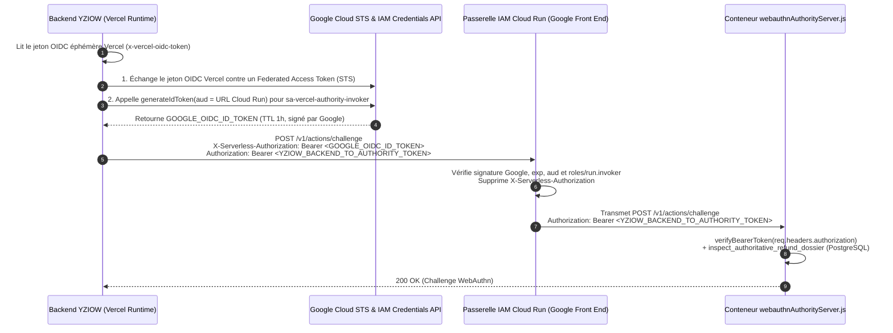

# YZIOW P28c — Chantier D.2.5 (Volet 2)
# Authentification Privée Vercel vers Google Cloud Run (IAM, OIDC et Faisabilité)

> **Statut :** Dossier de planification stricte D.2.5 / Durcissement D.2.5b — **Aucune fédération IAM ni clé cloud créée**.
> **État de la dépendance DEP-1 (`CLOUD_RUN_PRIVATE_INVOCATION_DEPENDENCY`) :** **IMPLÉMENTÉE DANS LE CODE LOCAL (D.2.5b)** — En attente de validation réelle lors du provisionnement Cloud Run autorisé (voir Section 2).
> **Références internes :** [webauthnAuthorityClient.js](file:///C:/Users/acer/Downloads/D-ambassador-fix/worktrees/p28c-clean/backend/services/webauthnAuthorityClient.js), [webauthnAuthorityServer.js](file:///C:/Users/acer/Downloads/D-ambassador-fix/worktrees/p28c-clean/backend/authority/webauthnAuthorityServer.js).

---

## 1. Architecture d'Authentification à Double Niveau (Infrastructure IAM + Applicatif)

Le service Cloud Run `yziow-webauthn-authority-stg` doit être déployé en mode **strictement privé au sens IAM** (`--no-allow-unauthenticated`). Toute requête entrante doit franchir successivement deux barrières indépendantes :

1. **Barrière 1 — Infrastructure Google Cloud Run (IAM / OIDC) :**
   - Vérifiée en amont du conteneur par le *Google Front End (GFE)* de Cloud Run.
   - Exige un jeton d'identité OpenID Connect (OIDC) signé par Google Cloud, transmis dans l'en-tête dédié :
     ```http
     X-Serverless-Authorization: Bearer <GOOGLE_OIDC_ID_TOKEN>
     ```
   - La signature du jeton, sa date d'expiration (`exp`), son audience exacte (`aud = https://yziow-webauthn-authority-stg-<hash>-ew.a.run.app`) et la possession du rôle `roles/run.invoker` par le compte `sa-vercel-authority-invoker` sont vérifiées par Google Cloud **avant** que le conteneur Node.js ne reçoive le moindre octet.
   - Conformément à la spécification officielle de Cloud Run, Google Cloud **priorise `X-Serverless-Authorization`** pour l'authentification IAM et **retire la signature du jeton** avant de transmettre la requête au conteneur (laissant le format `header.payload.` ou `header.payload`), tout en **préservant intégralement l'en-tête standard `Authorization`**. Le conteneur vérifie les claims (`iss`, `aud`, `exp`, `email`) en défense en profondeur sans exiger la signature déjà validée et retirée par Google Front End.

2. **Barrière 2 — Serveur d'Autorité Applicatif (`webauthnAuthorityServer.js`) :**
   - Vérifiée à l'intérieur du conteneur Node.js ([webauthnAuthorityServer.js](file:///C:/Users/acer/Downloads/D-ambassador-fix/worktrees/p28c-clean/backend/authority/webauthnAuthorityServer.js#L39-L53) et [L152-L159](file:///C:/Users/acer/Downloads/D-ambassador-fix/worktrees/p28c-clean/backend/authority/webauthnAuthorityServer.js#L152-L159)) par comparaison à temps constant (`crypto.timingSafeEqual`) sur l'en-tête applicatif conservé :
     ```http
     Authorization: Bearer <YZIOW_BACKEND_TO_AUTHORITY_TOKEN>
     ```



---

## 2. Résolution Technique de la Dépendance DEP-1 (`CLOUD_RUN_PRIVATE_INVOCATION_DEPENDENCY`) en D.2.5b

### 2.1 Implémentation dans `backend/services/webauthnAuthorityClient.js`

Dans le cadre du chantier **D.2.5b (Étape 1 — DEP-1)**, [backend/services/webauthnAuthorityClient.js](file:///C:/Users/acer/Downloads/D-ambassador-fix/worktrees/p28c-clean/backend/services/webauthnAuthorityClient.js) implémente désormais le flux complet sans clé statique :

1. **Récupération sécurisée et validation du jeton OIDC Vercel (`resolveVercelOidcSubjectToken` & `validateVercelOidcTokenClaims`) :**
   - Lecture depuis le contexte runtime officiel Vercel (`globalThis[Symbol.for('@vercel/request-context')]?.get()?.headers?.['x-vercel-oidc-token']`), `VERCEL_OIDC_TOKEN_FILE`, `VERCEL_OIDC_TOKEN` ou fournisseur injecté pour les tests.
   - Rejet immédiat (`STATIC_SERVICE_ACCOUNT_KEY_FORBIDDEN`) de toute clé JSON statique de Service Account Google Cloud.
   - Vérification de l'expiration (`exp`), du mode d'émetteur (`YZIOW_VERCEL_OIDC_ISSUER_MODE=team` : `https://oidc.vercel.com/<team_slug>`, ou `global` : `https://oidc.vercel.com`) et de la structure du sujet (`owner:<team>:project:<project>:environment:<env>`).
2. **Échange STS via Workload Identity Federation (`exchangeVercelTokenForStsAccessToken`) :**
   - Appel `POST https://sts.googleapis.com/v1/token` avec `grantType = urn:ietf:params:oauth:grant-type:token-exchange` et `audience = YZIOW_GCP_WIF_AUDIENCE`.
3. **Génération et validation stricte de l'OIDC ID Token Google Cloud Run (`requestGoogleCloudRunIdToken` & `validateGoogleCloudRunIdTokenClaims`) :**
   - Appel `POST https://iamcredentials.googleapis.com/v1/projects/-/serviceAccounts/<SA>:generateIdToken` avec `audience` fixée à l'URL exacte du service Cloud Run (`YZIOW_CLOUD_RUN_AUDIENCE` ou `YZIOW_WEBAUTHN_AUTHORITY_URL`) et `includeEmail: true`.
   - **Séparation stricte entre jeton d'accès STS et ID Token Cloud Run :** rejet explicite (`STS_ACCESS_TOKEN_NOT_ALLOWED_AS_ID_TOKEN`) si un jeton d'accès STS opaque (`ya29....` ou `token_use=access`) est présenté à la place d'un OIDC ID Token Google signé (`iss = https://accounts.google.com`, `aud = <URL Cloud Run>`, `exp > now`).
4. **Transmission du double en-tête et comportement fail-closed :**
   - Envoi simultané de `X-Serverless-Authorization: Bearer <GOOGLE_OIDC_ID_TOKEN>` et de `Authorization: Bearer <YZIOW_BACKEND_TO_AUTHORITY_TOKEN>`.
   - Aucun secret ni jeton n'est jamais journalisé.
   - Si l'authentification Cloud Run IAM est requise (`isCloudRunIamAuthRequired`) et que le jeton est absent, expiré ou invalide, l'appel échoue immédiatement en mode **fail-closed** (`503 AUTHORITY_UNAVAILABLE`) **sans aucun fallback non sécurisé**.
   - *Distinction méthodologique :* Les tests d'intégration locaux valident de manière déterministe la logique du client, la validation des claims JWT/OIDC, le rejet de confusion STS/ID Token et le mode fail-closed ; la validation bout-en-bout face au *Google Front End (GFE)* réel aura lieu lors de la recette sur le service Cloud Run après autorisation propriétaire de provisionnement.

---

## 3. Spécification des 8 Exigences de Sécurité de l'Étape C

### 3.1 Identité qui pourra invoquer Cloud Run
- **Service Account Google Cloud dédié :**
  `sa-vercel-authority-invoker@yziow-sec-auth-staging.iam.gserviceaccount.com`
- Ce compte de service ne possède **aucune clé privée JSON téléchargée** (`iam.disableServiceAccountKeyCreation` applicable au projet).
- Il ne peut être emprunté (*impersonated*) que par le fournisseur Workload Identity Pool `vercel-oidc-stg` lorsque le jeton OIDC émis par Vercel respecte la condition d'attribut stricte :
  ```cel
  assertion.sub == "owner:sakanacim-6028s-projects:project:yzo-school:environment:preview"
  ```
  *(En production future, un second pool/provider séparé n'acceptera que `:environment:production` vers le projet `yziow-sec-auth-prod`).*

### 3.2 Droits minimaux `roles/run.invoker`
- Le rôle `roles/run.invoker` (permission unique `run.routes.invoke`) est accordé à `sa-vercel-authority-invoker` **exclusivement sur la ressource du service Cloud Run** `yziow-webauthn-authority-stg` (via `gcloud run services add-iam-policy-binding`), et **jamais** au niveau global du projet GCP.
- `allUsers` et `allAuthenticatedUsers` sont formellement interdits sur la politique IAM du service Cloud Run.

### 3.3 Moyens d'obtenir des jetons de courte durée (sans clé JSON permanente)
Le flux d'échange OIDC standard sans SDK lourd (réalisable en 2 appels HTTPS `fetch` natifs Node.js ou via `google-auth-library`) fonctionne en trois étapes :
1. **Lecture du jeton OIDC Vercel :**
   - Lecture de `process.env.VERCEL_OIDC_TOKEN` ou de l'en-tête de requête entrante `x-vercel-oidc-token` fourni par le runtime Serverless Vercel (validité 2 heures).
2. **Échange STS Google Cloud (`https://sts.googleapis.com/v1/token`) :**
   - `grantType`: `urn:ietf:params:oauth:grant-type:token-exchange`
   - `audience`: `//iam.googleapis.com/projects/<PROJECT_NUMBER>/locations/global/workloadIdentityPools/vercel-yziow-pool/providers/vercel-oidc-stg`
   - `scope`: `https://www.googleapis.com/auth/cloud-platform`
   - `requestedTokenType`: `urn:ietf:params:oauth:token-type:access_token`
   - `subjectTokenType`: `urn:ietf:params:oauth:token-type:jwt`
   - `subjectToken`: `<VERCEL_OIDC_TOKEN>`
   - Retourne un jeton d'accès fédéré de courte durée.
3. **Émission de l'ID Token Cloud Run (`https://iamcredentials.googleapis.com/v1/projects/-/serviceAccounts/sa-vercel-authority-invoker@yziow-sec-auth-staging.iam.gserviceaccount.com:generateIdToken`) :**
   - Corps JSON : `{ "audience": "<YZIOW_WEBAUTHN_AUTHORITY_URL>", "includeEmail": true }`
   - Retourne un `token` OIDC signé par Google (validité 3600 secondes / 1 heure), mis en cache en mémoire pendant 50 minutes pour éviter un appel STS à chaque requête.

### 3.4 Contrôle strict du champ `aud` (Audience)
- Lors de l'appel à `generateIdToken`, le paramètre `audience` est fixé à l'URL HTTPS canonique exacte du service Cloud Run (`YZIOW_WEBAUTHN_AUTHORITY_URL`, ex. `https://yziow-webauthn-authority-stg-<hash>-ew.a.run.app`).
- La passerelle IAM de Cloud Run vérifie cryptographiquement que le claim `aud` du JWT dans `X-Serverless-Authorization` correspond à l'URL du service Cloud Run ciblé. Un jeton émis pour un autre service est rejeté avec `401/403`.

### 3.5 Protection contre le rejeu et l'usurpation
La défense contre le rejeu et l'usurpation repose sur 4 couches cumulatives :
1. **TLS 1.3 de bout en bout** entre Vercel et `*.a.run.app` (empêche l'interception réseau des en-têtes `X-Serverless-Authorization` et `Authorization`).
2. **Durée de vie courte du jeton OIDC Google (1 heure)** et liaison cryptographique au claim `aud` et à `email = sa-vercel-authority-invoker@...`.
3. **Jeton applicatif indépendant (`YZIOW_BACKEND_TO_AUTHORITY_TOKEN`)** vérifié en temps constant par `webauthnAuthorityServer.js`.
4. **Incapacité structurelle du jeton d'invocation à forger une preuve :** même si un attaquant dérobait à la fois le jeton OIDC `sa-vercel-authority-invoker` et `YZIOW_BACKEND_TO_AUTHORITY_TOKEN`, il ne pourrait obtenir aucune preuve d'action sans une **signature matérielle WebAuthn (`UP=1, UV=1`)** produite par l'authentificateur physique d'un SuperAdmin sur un challenge à usage unique de 5 minutes, et sans que le dossier n'existe réellement dans PostgreSQL (`inspect_authoritative_refund_dossier`).

### 3.6 Comportement si l'identité est expirée ou indisponible (Fail-Closed)
- Si le jeton OIDC Vercel est absent, expiré, ou si l'API STS Google est injoignable, ou si la passerelle Cloud Run renvoie `401`/`403` :
  - `webauthnAuthorityClient.js` ne tente **aucun fallback local** (`isExternalAuthorityRequired()` vaut `true` dès que `NODE_ENV !== 'test'` ou que `YZIOW_WEBAUTHN_AUTHORITY_URL` est défini).
  - Il retourne immédiatement `{ ok: false, status: 503, body: { success: false, valid: false, code: 'AUTHORITY_UNAVAILABLE' } }`.
  - Toute opération d'enrôlement ou de rapprochement de remboursement est bloquée en mode fail-closed.

### 3.7 Révocation immédiate des droits (< 60 secondes)
En cas de suspicion de compromission du runtime Vercel, le propriétaire dispose de trois leviers de révocation immédiate depuis la console Google Cloud (sans dépendre de Vercel) :
1. **Retrait du binding `roles/run.invoker`** sur `yziow-webauthn-authority-stg` pour `sa-vercel-authority-invoker`.
2. **Désactivation du Workload Identity Provider** `vercel-oidc-stg` (bloque instantanément tout nouvel échange STS).
3. **Désactivation du Service Account** `sa-vercel-authority-invoker`.

### 3.8 Protection des endpoints contre les appels publics
- Le déploiement Cloud Run utilise obligatoirement `--no-allow-unauthenticated` et `--ingress=all` (requis car Vercel Serverless ne possède pas d'IP fixe gratuite ni de tunnel VPC vers GCP sur les plans standards, mais **chaque requête non munie d'un jeton IAM `roles/run.invoker` valide est bloquée en périphérie par le Google Front End avant d'atteindre le conteneur** — y compris `GET /v1/health` depuis l'extérieur, tandis que les sondes internes de santé de Cloud Run s'exécutent à l'intérieur de l'infrastructure Google).

---

## 4. Comparatif des Alternatives d'Invocation Privée et Leurs Limites

Si le propriétaire souhaite évaluer les alternatives à la fédération OIDC directe (WIF) :

| Approche | Sécurité | Modification de `webauthnAuthorityClient.js` requise ? | Limites techniques / financières | Recommandation |
|---|---|---|---|---|
| **Option C.1 (Recommandée) : Workload Identity Federation (OIDC Vercel → GCP STS) + `X-Serverless-Authorization`** | **Maximale** (Zéro clé statique longue durée dans Vercel ; jetons de 1h ; révocation IAM instantanée) | **Oui (mineure)** : ajout de l'échange OIDC STS + en-tête `X-Serverless-Authorization` (~45 lignes dans `webauthnAuthorityClient.js`) | Nécessite d'activer OIDC Federation dans les paramètres du projet Vercel et d'autoriser ce petit correctif code avant le déploiement Cloud Run. | **RECOMMANDÉE** |
| **Option C.2 : Passerelle mandataire d'authentification (Cloudflare Worker / Cloud Functions proxy)** | **Moyenne** (Déplace le problème d'authentification entre Vercel et le mandataire) | **Non** (si le mandataire injecte lui-même `X-Serverless-Authorization`) | Ajoute un composant réseau tiers supplémentaire à sécuriser et maintenir ; n'élimine pas le besoin d'authentifier Vercel auprès du mandataire. | Non retenue (complexité inutile) |
| **Option C.3 : Clé JSON de Service Account stockée dans Vercel pour signer un JWT OIDC localement** | **Dégradée** (Clé privée RSA longue durée stockée dans les variables d'environnement Vercel) | **Oui** (génération d'ID Token à partir de la clé JSON et envoi dans `X-Serverless-Authorization`) | **Interdite par défaut par l'Étape C** : expose une clé permanente dans Vercel qui, en cas de fuite des variables Vercel, resterait valide jusqu'à révocation manuelle. | **ÉCARTÉE** |
| **Option C.4 : Cloud Run `--allow-unauthenticated` avec seul `YZIOW_BACKEND_TO_AUTHORITY_TOKEN`** | **Insuffisante** | **Non** | **Strictement interdite par l'Étape C** : expose les endpoints du conteneur aux scanners publics Internet sans filtrage IAM Google en périphérie. | **INTERDITE** |

---

## 5. Références Officielles

- Google Cloud Run — Authentification service-à-service et en-tête `X-Serverless-Authorization` : https://cloud.google.com/run/docs/authenticating/service-to-service
- Google Cloud IAM — Workload Identity Federation avec fournisseurs OIDC : https://cloud.google.com/iam/docs/workload-identity-federation-with-other-providers
- Vercel Docs — Connect to Google Cloud Platform (GCP) via OIDC Federation : https://vercel.com/docs/security/oidc-federation/gcp
